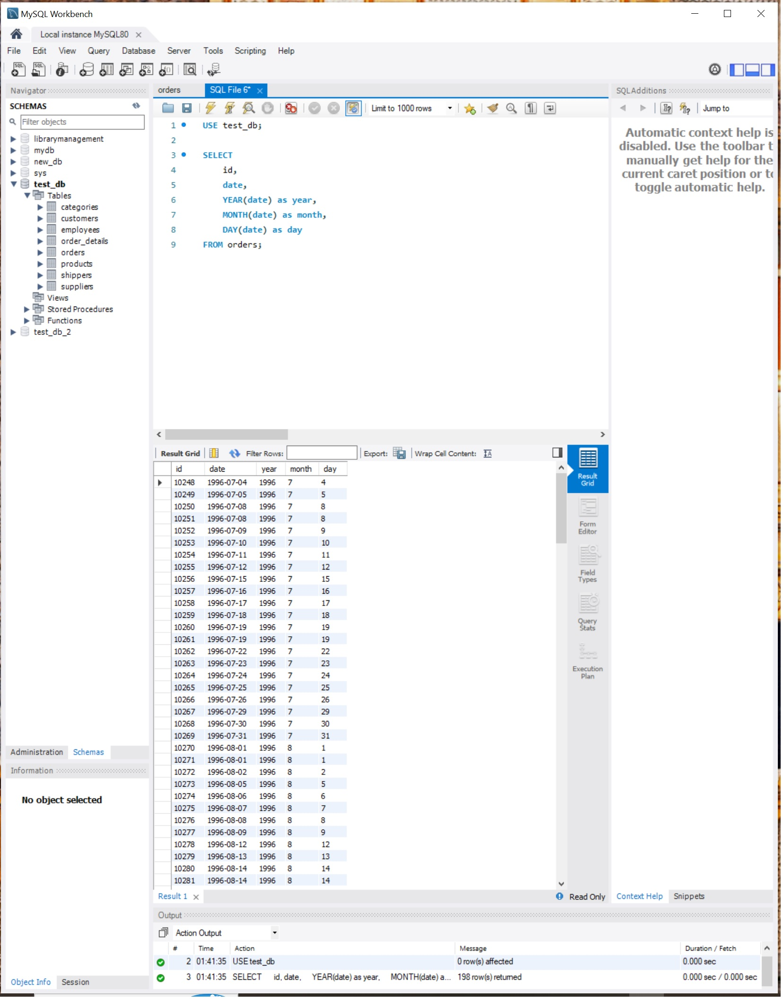
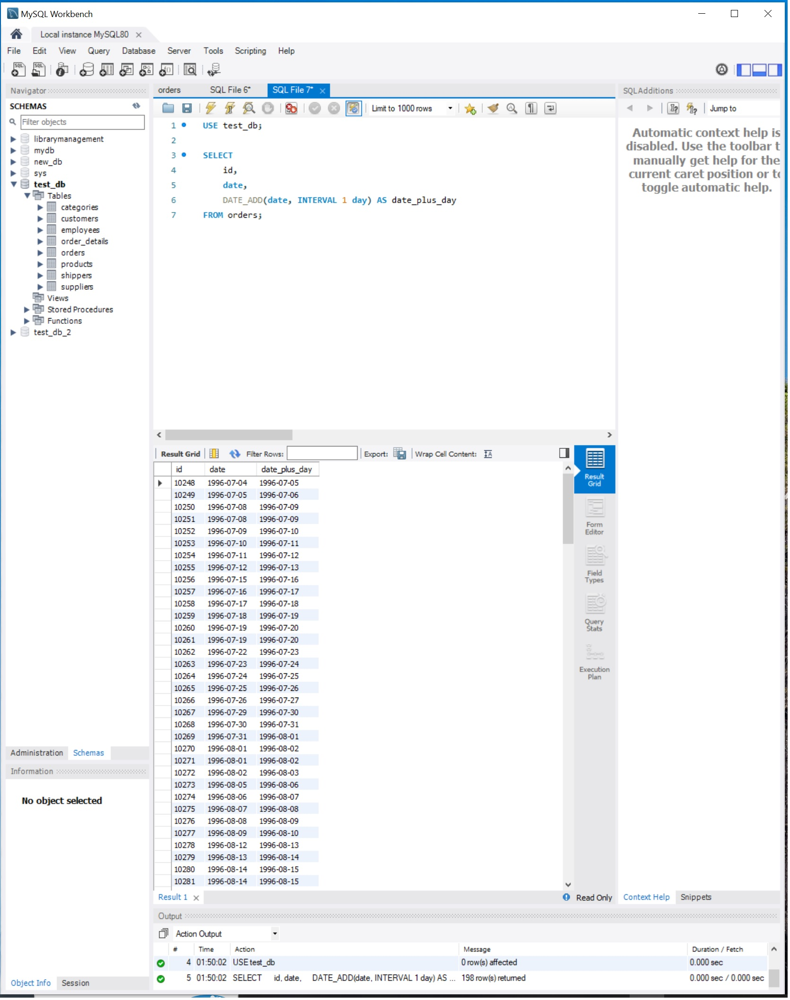
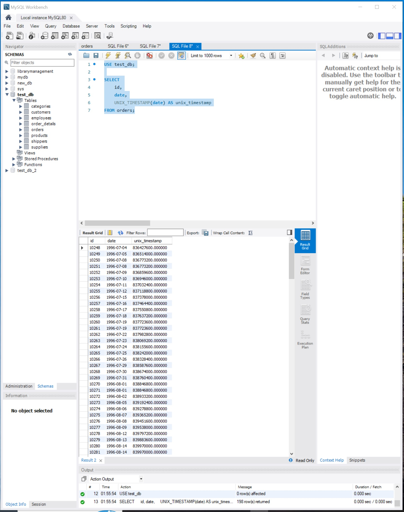
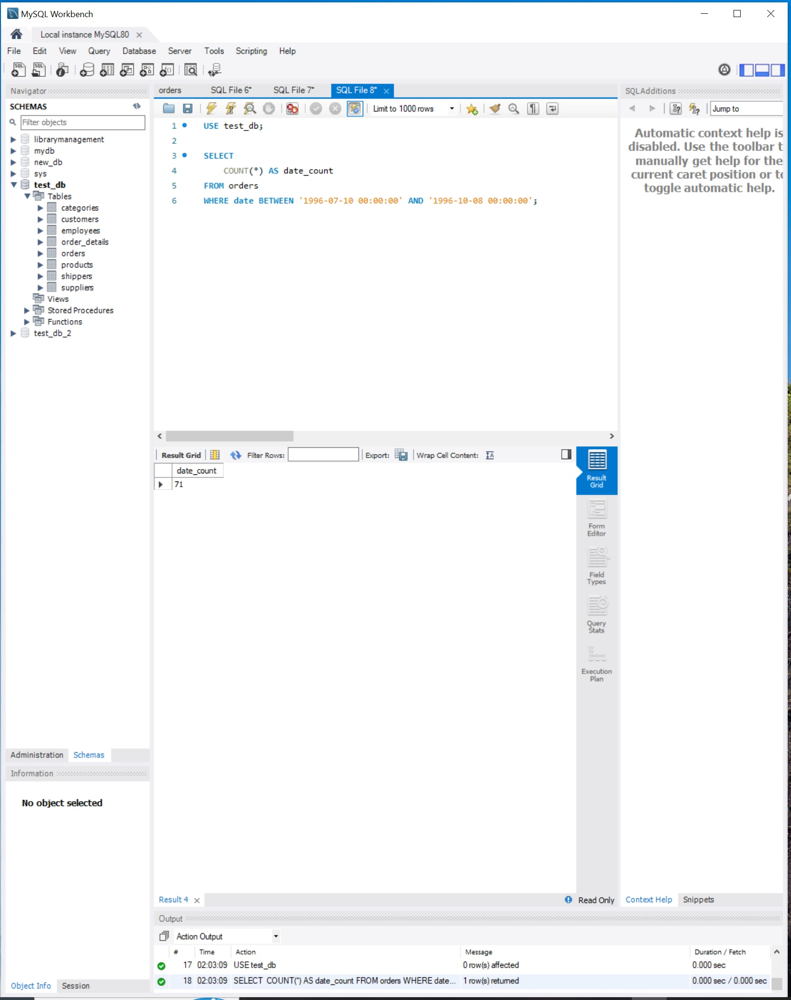
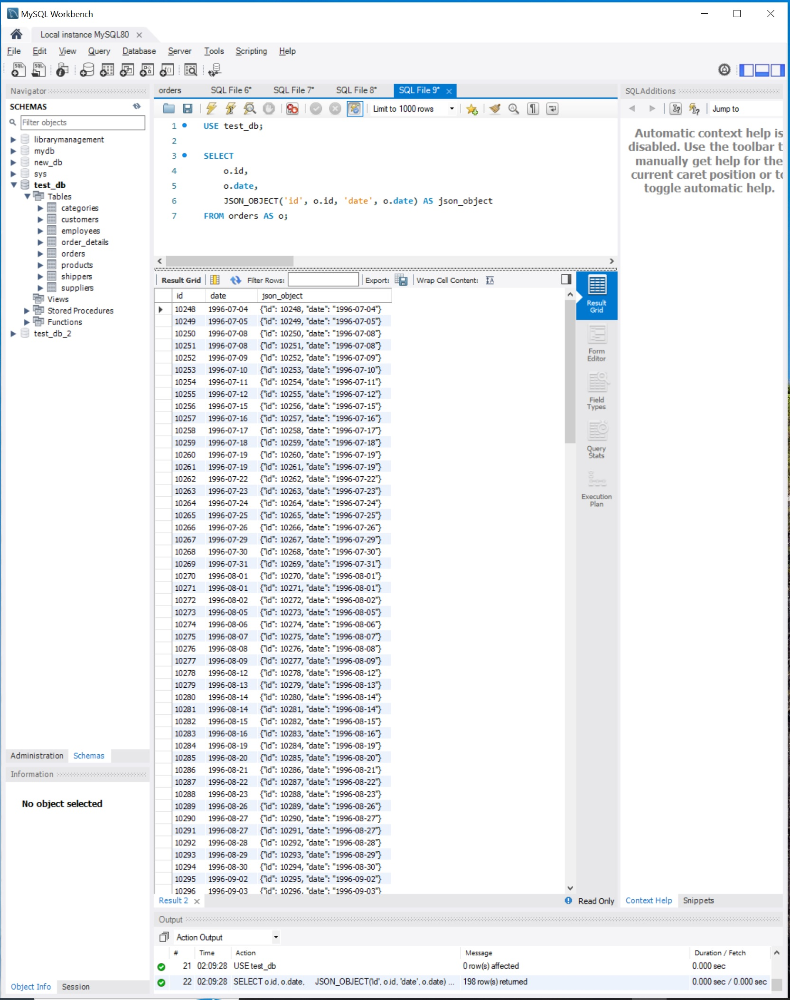

# Практичні завдання з SQL (Робота з датами та JSON)

---

### Завдання 1
**Умова:** Напишіть SQL-запит, який для таблиці `orders` з атрибута `date` витягує рік, місяць і число. Виведіть на екран їх у три окремі атрибути поряд з атрибутом `id` та оригінальним атрибутом `date` (всього вийде 5 атрибутів).

**Виконання:**
```sql
USE test_db;

SELECT 
    id,
    date,
    YEAR(date) as year,
    MONTH(date) as month,
    DAY(date) as day
FROM orders;
```

**Результат виконання:**


---

### Завдання 2
**Умова:** Напишіть SQL-запит, який для таблиці `orders` до атрибута `date` додає один день. На екран виведіть атрибут `id`, оригінальний атрибут `date` та результат додавання.

**Виконання:**
```sql
USE test_db;

SELECT 
    id,
    date,
    DATE_ADD(date, INTERVAL 1 day) AS date_plus_day
FROM orders;
```

**Результат виконання:**


---

### Завдання 3
**Умова:** Напишіть SQL-запит, який для таблиці `orders` для атрибута `date` відображає кількість секунд з початку відліку (показує його значення timestamp). Для цього потрібно знайти та застосувати необхідну функцію. На екран виведіть атрибут `id`, оригінальний атрибут `date` та результат роботи функції.

**Виконання:**
```sql
USE test_db;

SELECT 
    id,
    date,
    UNIX_TIMESTAMP(date) AS unix_timestamp
FROM orders;
```

**Результат виконання:**


---

### Завдання 4
**Умова:** Напишіть SQL-запит, який рахує, скільки таблиця `orders` містить рядків з атрибутом `date` у межах між `1996-07-10 00:00:00` та `1996-10-08 00:00:00`.

**Виконання:**
```sql
USE test_db;

SELECT 
    COUNT(*) AS date_count
FROM orders
WHERE date BETWEEN '1996-07-10 00:00:00' AND '1996-10-08 00:00:00';
```

**Результат виконання:**


---

### Завдання 5
**Умова:** Напишіть SQL-запит, який для таблиці `orders` виводить на екран атрибут `id`, атрибут `date` та JSON-об’єкт `{"id": <атрибут id рядка>, "date": <атрибут date рядка>}`. Для створення JSON-об’єкта використайте функцію.

**Виконання:**
```sql
USE test_db;

SELECT
    o.id,
    o.date,
    JSON_OBJECT('id', o.id, 'date', o.date) AS json_object
FROM orders AS o;
```

**Результат виконання:**


---